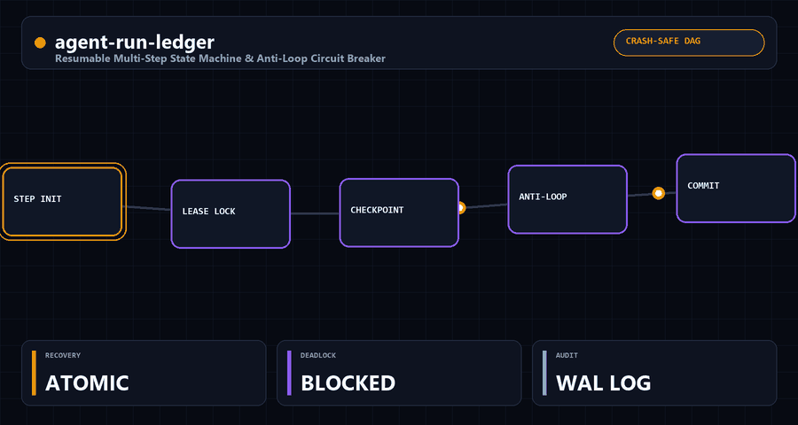
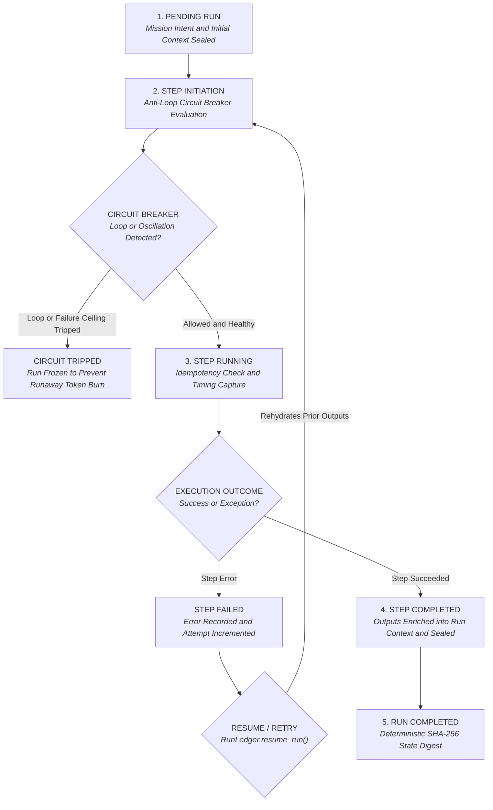

<div align="center">


<br/>

<br/>

[](https://pypi.org/project/agent-run-ledger/)
[](https://github.com/BenniAlencar/agent-run-ledger/actions/workflows/ci.yml)
[](#-test-suite--verification)
[](https://www.python.org/)
[](https://modelcontextprotocol.io/)
[](LICENSE)
[](https://github.com/BenniAlencar)
[](https://benni-os.net)
[](https://glama.ai/mcp/servers/BenniAlencar/agent-run-ledger)

<br/>

> **"Never let a process crash kill an agent run. Never let a tool loop burn your token budget."**


<p align="center">
  <b>The missing durable execution layer for autonomous AI agents.</b><br>
  Replace fragile Python scripts with a deterministic, crash-resilient state machine, anti-loop tripwires, and zero-cost resume.
</p>

<br/>



<br/><br/>

[Quickstart](#-quickstart-in-30-seconds) •
[Why Agent Runs Fail](#-the-3-fatal-failures-of-autonomous-agent-runs) •
[Architecture](#-durable-state-machine-architecture) •
[Anti-Loop Breaker](#-anti-loop-circuit-breaker) •
[MCP Integration](#-model-context-protocol-mcp-server) •
[Enterprise Benni OS](#-from-run-ledger-to-sovereign-ai-swarms)

</div>

<br/>

## ⚡ The 3 Fatal Failures of Autonomous Agent Runs

In 2026, developers building autonomous agents with LangChain, CrewAI, AutoGen, or custom MCP loops face three catastrophic operational failures:

1. **The Crash of Death (Zero Resumability)**: An agent plans a 10-step mission. At step 7, an API times out, rate-limits, or the process restarts. The entire run is lost. Re-running the agent for
2. **The Hallucinatory Ping-Pong & Runaway Loop**: When an agent gets stuck or two agents collaborate in a delegation swarm, they frequently enter repetitive tool loops (calling `search_web` with [...]
3. **Non-Idempotent Duplicate Side-Effects**: Without step-level idempotency keys, re-attempting a failed workflow risks charging credit cards twice, sending duplicate webhook alerts, or creating [...]

**Agent Run Ledger solves this permanently.** Derived from the **Benni Master OS v9.4 Doctrine (Skill 90c Run Ledger Protocol & Skill 83 Background Execution OS)**, it brings lightweight, zero-dep[...]

<br/>


## 🏗️ Durable State Machine Architecture

Every agent mission in Agent Run Ledger is governed as a deterministic directed finite-state machine:

```text
  LangChain / CrewAI / AutoGen / MCP Clients / Python Agents
         │
         ├──► RunLedger.execute_step(run_id, name, inputs)
         └──► McpRunLedgerServer (JSON-RPC 2.0 Tools)
                       │
                       ▼
  ┌───────────────────────────────────────────────────────────────�[...]
  │                        agent-run-ledger                             │
  │                                                                     │
  │  ┌───────────────────┐  ┌───────────────────┐  ┌─────────────────┐  [...]
  │  │ Anti-Loop Circuit │  │  Durable Step     │  │ Atomic          │  │
  │  │ Breaker           │─►│  State Machine    │─►│ Checkpoint      │  │
  │  │ • Loop Detection  │  │  • PENDING/RUNNING│  │ • SHA-256 Seal  │  │
  │  │ • Oscillation A-B │  │  • COMPLETED/FAIL │  │ • Tamper Guard  │  │
  │  │ • Failure Ceiling │  │  • Compensation   │  │ • File Restore  │  │
  │  └───────────────────┘  └───────────────────┘  └─────────────────┘  [...]
  │                                                                     │
  │  ┌───────────────────┐  ┌───────────────────┐  ┌─────────────────┐  [...]
  │  │ Storage Backends  │  │  Framework        │  │ Tools & CLI     │  │
  │  │ • SQLite WAL      │  │  Adapters         │  │ • doctor        │  │
  │  │ • In-Memory       │  │  • LangChain      │  │ • bench_matrix  │  │
  │  │ • BaseLedgerABC   │  │  • CrewAI / MCP   │  │ • inspect/list  │  │
  │  └───────────────────┘  └───────────────────┘  └─────────────────┘  [...]
  └───────────────────────────────────────────────────────────────�[...]
         │                                         │
         ▼                                         ▼
   SQLite WAL Ledger (agent_runs.db)        SHA-256 Sealed Checkpoints
   Crash-Resilient Step & Context State     Tamper-Evident Run Snapshots
```

See [docs/ARCHITECTURE.md](docs/ARCHITECTURE.md) for the full internal specification.



> **The Resumability Law**: When a run is interrupted or fails at step $N$, calling `resume_run()` preserves all outputs from steps $1 \dots N-1$, resets consecutive failure counters, and continu[...]

<br/>


## 🚀 Quickstart in 30 Seconds

### 1. Installation

```bash
pip install agent-run-ledger
```

### 2. Wrap Multi-Step Agent Execution with `execute_step`

```python
from run_ledger import RunLedger

# Initialize durable ledger with SQLite persistence
ledger = RunLedger.with_sqlite("agent_runs.db")

run = ledger.create_run(intent="Deploy production microservice", context={"env": "prod"})

# Step 1: Pre-flight checks
with ledger.execute_step(run_id=run.id, name="preflight_check", inputs={"cluster": "k8s"}) as s1:
    s1.outputs = {"cluster_ready": True, "nodes": 8}

# Step 2: Build container
with ledger.execute_step(run_id=run.id, name="build_container", inputs={"tag": "v1.2.0"}) as s2:
    s2.outputs = {"digest": "sha256:7f8a...", "size_mb": 180}

print("Run Status:", run.status.value)       # "completed"
print("Steps Completed:", run.completed_steps) # 2
```

### 3. Crash Recovery & Zero-Cost Resume

If step 3 fails due to a network glitch or process kill, resume instantly without re-running steps 1 and 2:

```python
# Rehydrate interrupted run
resumed_run = ledger.resume_run(run_id=run.id)

# Previous outputs are already in the context!
print(resumed_run.context["digest"]) # "sha256:7f8a..."

# Continue execution from step 3
with ledger.execute_step(run_id=run.id, name="deploy_service", inputs={"replicas": 3}) as s3:
    s3.outputs = {"endpoint": "https://api.bennios.dev"}
```

### 4. Step-Level Idempotency (Prevent Duplicate Side-Effects)

```python
# Even if invoked multiple times, steps with identical idempotency keys execute only once
with ledger.execute_step(
    run_id=run.id,
    name="charge_customer",
    inputs={"amount_cents": 5000},
    idempotency_key="invoice_order_4421",
) as step:
    step.outputs = {"charge_id": "ch_987", "status": "paid"}
```

<br/>


## 🛡️ Anti-Loop Circuit Breaker

`agent-run-ledger` monitors agent actions in real time, detecting pathological behavior before runaway token burn occurs:

| Detection Mode | Pattern | Safety Trip Condition |
|---|---|---|
| **Identical Action Loop** | Same tool called with identical inputs repeatedly | Trips if action repeats $N$ times consecutively |
| **State Oscillation** | Agent ping-pongs between Action A and Action B ($A \to B \to A \to B$) | Trips on alternating state sequence |
| **Consecutive Failures** | Repeated exceptions or missing prerequisites | Trips when consecutive failure threshold is exceeded |
| **Step Budget Ceiling** | Unbounded autonomous runaway | Trips if total run steps exceed safety ceiling |

```python
from run_ledger import RunLedger, CircuitBreakerConfig, CircuitBreakerTripped

# Set trip limits
config = CircuitBreakerConfig(max_repeated_actions=3, max_consecutive_failures=3)
ledger = RunLedger(circuit_config=config)

try:
    for _ in range(5):
        # Simulating an agent hallucinating identical search queries
        with ledger.execute_step(run_id=run.id, name="search_web", inputs={"q": "benni os"}):
            pass
except CircuitBreakerTripped as cbt:
    print(f"Loop blocked: {cbt.reason}") # "Repeated identical action 'search_web' (3 times)"
```

<br/>


## 🔄 Step Compensation & Rollback Protocol

When a multi-step operation fails midway through, `agent-run-ledger` executes rollback handlers in reverse order:

```python
handlers = {
    "allocate_ip": lambda step: release_cloud_ip(step.outputs["ip_address"]),
    "create_ebs_volume": lambda step: delete_ebs_volume(step.outputs["volume_id"]),
}

# Automatically rolls back completed steps in reverse order
rolled_back = ledger.compensate_run(run.id, handlers)
print(f"Compensated {len(rolled_back)} steps.")
```

<br/>


## 📊 Comparison: Agent Run Ledger vs. Existing Alternatives

| Capability | Heavy Orchestrators (Temporal / Inngest) | Raw LangChain / CrewAI Scripts | **agent-run-ledger** |
| | :--- | :---: | :---: | :---: |
| **Infrastructure Overhead** | Heavy (requires daemon server clusters) | None | **Zero (Embedded SQLite or Memory)** |
| **Crash Resumability** | ✅ Yes | ❌ Lost on process exit | **✅ Instant (`resume_run()`)** |
| **Anti-Loop Circuit Breaker** | ❌ Manual coding | ❌ No | **✅ Built-In (Loop + Oscillation)** |
| **Step-Level Idempotency** | Complex setup | ❌ No | **✅ Native (`idempotency_key`)** |
| **Reverse Step Rollback** | Complex saga definitions | ❌ No | **✅ Native (`compensate_run()`)** |
| **Model Context Protocol (MCP)** | ❌ No | ❌ No | **✅ Native Tool Server Built-In** |
| **Runtime Overhead** | High network serialization | Zero | **Sub-millisecond (< 1ms)** |

<br/>


## 🔌 Model Context Protocol (MCP) Server

`agent-run-ledger` includes a built-in MCP server for **Claude Desktop**, **Cursor**, **Windsurf**, and **Antigravity**:

```python
from run_ledger import McpRunLedgerServer

server = McpRunLedgerServer()

# Built-in native tools exposed to the agent:
# • ledger_create_run: Initializes durable run ledger with intent and context
# • ledger_step_start: Registers and starts a step (evaluated by circuit breaker)
# • ledger_step_complete: Marks step as completed with output payload
# • ledger_step_fail: Records error and marks step as failed
# • ledger_run_resume: Rehydrates an interrupted run to continue execution
# • ledger_circuit_status: Inspects active anti-loop tripwire status
```

<br/>


## 🧩 Framework Integrations

### LangChain & LangGraph
```python
from run_ledger import RunLedger, RunLedgerCallbackHandler
from langchain.agents import AgentExecutor

ledger = RunLedger.with_sqlite("agent_runs.db")
handler = RunLedgerCallbackHandler(ledger=ledger)

# Hooks into agent cycles to record tool calls as durable ledger steps
agent_executor.invoke({"input": "Perform research"}, config={"callbacks": [handler]})
```

### CrewAI
```python
from run_ledger import RunLedger, RunLedgerCrewWrapper

ledger = RunLedger.with_sqlite("agent_runs.db")
wrapper = RunLedgerCrewWrapper(ledger=ledger, run_id=run.id)

# Wrap any CrewAI tool with durable ledger tracking
protected_tool = wrapper.wrap_tool(my_crew_tool, name="search_database")
```

<br/>


## 💻 Terminal CLI & Audit Suite

```bash
# Display brand, version, and architecture doctrine
run-ledger info

# List recent runs and completion progress
run-ledger list

# Inspect full step-by-step trace of a run
run-ledger inspect <run_id>

# Rehydrate an interrupted run
run-ledger resume <run_id>

# Export an atomic SHA-256 sealed checkpoint snapshot
run-ledger snapshot <run_id> checkpoint.json

# Probe environment, SQLite WAL persistence & checkpoint integrity
run-ledger doctor

# Run multi-backend step throughput benchmark matrix
run-ledger matrix --steps 10,50,100
```

<br/>


## 📁 Project Structure

```text
agent-run-ledger/
├── docs/
│   └── ARCHITECTURE.md                # Skill 90c/83 durable state machine specification
├── examples/
│   ├── 01_resumable_run.py            # Multi-step run with crash recovery & resume
│   ├── 02_anti_loop_circuit_breaker.py# Loop, oscillation & failure ceiling tripwires
│   ├── 03_step_compensation_rollback.py# Reverse-order Saga compensation rollback
│   └── 04_mcp_run_ledger.py           # Model Context Protocol (MCP) server integration
├── run_ledger/
│   ├── __init__.py                    # Public package exports
│   ├── version.py                     # Version, doctrine & maintainer metadata
│   ├── adapters/
│   │   ├── __init__.py                # Adapter exports
│   │   ├── crewai.py                  # CrewAI tool & task ledger wrapper
│   │   ├── langchain.py               # LangChain callback handler integration
│   │   └── mcp_server.py              # Native MCP JSON-RPC 2.0 server
│   ├── cli/
│   │   ├── __init__.py                # CLI package marker
│   │   └── main.py                    # Click + Rich CLI (info, list, inspect, resume, doctor, matrix)
│   ├── core/
│   │   ├── __init__.py                # Core engine exports
│   │   ├── checkpoint.py              # SHA-256 sealed atomic run snapshots
│   │   ├── circuit_breaker.py         # Anti-loop, oscillation & budget tripwires
│   │   ├── ledger.py                  # RunLedger durable execution state machine
│   │   └── models.py                  # Pydantic RunRecord, StepRecord & status enums
│   ├── storage/
│   │   ├── __init__.py                # Storage backend exports
│   │   ├── base.py                    # Abstract BaseLedgerStorage interface
│   │   ├── memory.py                  # Zero-I/O InMemoryLedgerStorage backend
│   │   └── sqlite.py                  # ACID SQLite WAL persistence backend
│   └── tools/
│       ├── __init__.py                # Diagnostics & benchmark tool exports
│       ├── bench_matrix.py            # Multi-backend step throughput benchmark matrix
│       └── doctor.py                  # Environment, SQLite WAL & checkpoint probe
├── scripts/
│   ├── benchmark_ledger_throughput.py # In-memory vs SQLite WAL throughput benchmark
│   └── gate_anti_loop_runner.py       # Fail-closed anti-loop & crash-resume gate runner
└── tests/
    ├── __init__.py                    # Test suite package marker
    ├── conftest.py                    # Shared pytest fixtures
    ├── test_adapters.py               # MCP, LangChain & CrewAI adapter tests
    ├── test_circuit_breaker.py        # Loop, oscillation & budget tripwire tests
    ├── test_cli.py                    # Click CLI command tests
    ├── test_ledger_execution.py       # Step execution, idempotency & rollback tests
    ├── test_models_and_states.py      # Record hashing & state transition tests
    ├── test_resumability_and_checkpoint.py # Crash recovery & tamper rejection tests
    ├── test_sqlite_persistence.py     # SQLite WAL persistence tests
    └── test_tools_and_scripts.py      # Doctor, bench_matrix & gate script tests
```

<br/>


## 🌐 The Benni OS Open-Source Ecosystem

`agent-run-ledger` is part of the **Benni OS** decentralized agentic infrastructure. Explore the 17 open-source repositories powering sovereign AI agents:

| Repository | Focus & Architecture | Stars |
| :--- | :--- | :---: |
| **[`conductor-sdd`](https://github.com/Benni-OS/conductor-sdd)** | Zero-Dependency Spec-Driven Development, Static AST Drift Detector & MCP Guardrail | [** | High-Throughput Sovereign Local Inference for 8GB–16GB Consumer GPUs | [** | Deterministic Zero-Cloud Agent Evaluation, Red-Teaming & Benchmark Harness | [** | Micro-Second Zero-Dependency Code Sandbox & Execution Shield for AI Agents | [** | Autonomous Multi-Source Deep Research & Evidence Synthesis Engine | [** | Token-Saving Resilient Headless Browser Automation & A11y DOM Compiler | [** | Deterministic Intent Compiler & Typed DAG Execution Planner for AI Agents | [** | Sub-Millisecond Context Compression & Semantic Deduplication Engine | [** | Real-Time Biometric Swarm Governance & 120 FPS Resonant Kinetic Interface | [** | Zero-Trust Runtime Security, Prompt Injection Firewall & Secrets Redaction | [** | Deterministic Multi-Step Task Execution Ledger & Anti-Looping Engine | [** | Cryptographic State Verification & Invariant Proof Engine for Agents | [** | Hybrid Vector + BM25 Hierarchical Session Memory & Continuity Engine | [** | Human-in-the-Loop Approval & Policy Enforcement Gateway | [** | Rapid Model Context Protocol (MCP) Server Scaffolding & Dynamic Tooling | [** | Autonomous Multi-Agent Intent Routing & Swarm Coordination Hub | [** | Autonomous GitHub Community Triaging & PR Feedback Agent | [
* **Benni OS Engineering Academy**: [https://benni-os.net/blog/academy.html](https://benni-os.net/blog/academy.html)
* **Benni OS GitHub Organization**: [https://github.com/Benni-OS](https://github.com/Benni-OS)
* **Lead Architect & Maintainer**: [https://github.com/BenniAlencar](https://github.com/BenniAlencar)

<br/>


## 🤝 Contributing

We welcome contributions! Please see [CONTRIBUTING.md](CONTRIBUTING.md). All pull requests must pass 100% of tests (`pytest tests`).

## 📄 License & Provenance

Agent Run Ledger is licensed under the [Apache License, Version 2.0](LICENSE).

© 2026 [Benni OS](https://benni-os.net) Core Engineering Group — Engineered by [Benni Alencar](https://github.com/BenniAlencar). All rights reserved.

<br/>

<div align="center">


**agent-run-ledger** — *Part of the [Benni OS](https://benni-os.net) Core Engineering Group*

`AGENT_RUN_LEDGER` • `SKILL_90C_NATIVE` • `DURABLE_EXECUTION` • `ANTI_LOOP_BREAKER` • `APACHE_2.0`

Engineered by [**Benni Alencar**](https://github.com/BenniAlencar) & the [**Benni OS**](https://github.com/Benni-OS) Core Engineering Group

</div>
