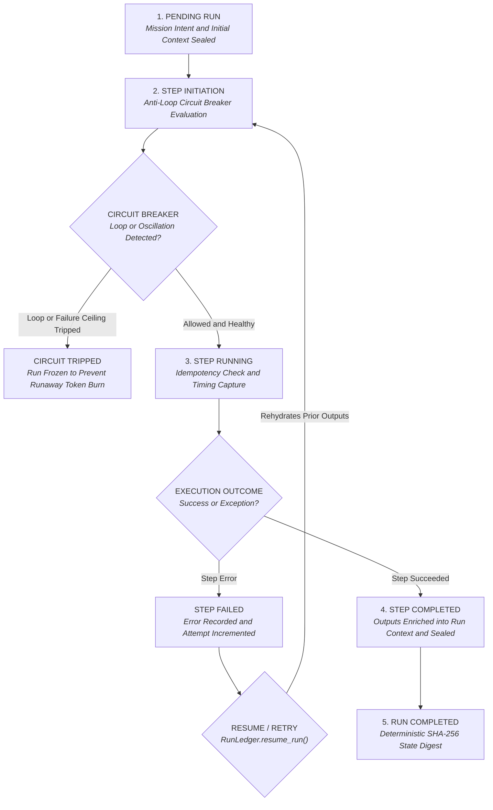

<div align="center">


<br/>


<br/><br/>

[](https://github.com/BenniAlencar/agent-run-ledger/actions/workflows/ci.yml)
[](#-test-suite--verification)
[](https://www.python.org/)
[](https://modelcontextprotocol.io/)
[](LICENSE)
[](https://github.com/BenniAlencar)

<br/>

> **"Never let a process crash kill an agent run. Never let a tool loop burn your token budget."**


<p align="center">
  <b>The missing durable execution layer for autonomous AI agents.</b><br>
  Replace fragile Python scripts with a deterministic, crash-resilient state machine, anti-loop tripwires, and zero-cost resume.
</p>

[Quickstart](#-quickstart-in-30-seconds) •
[Why Agent Runs Fail](#-the-3-fatal-failures-of-autonomous-agent-runs) •
[Architecture](#-durable-state-machine-architecture) •
[Anti-Loop Breaker](#-anti-loop-circuit-breaker) •
[MCP Integration](#-model-context-protocol-mcp-server) •
[Enterprise Benni OS](#-from-run-ledger-to-sovereign-ai-swarms)

</div>

<br/>

## ⚡ The 3 Fatal Failures of Autonomous Agent Runs

In 2026, developers building autonomous agents with LangChain, CrewAI, AutoGen, or custom MCP loops face three catastrophic operational failures:

1. **The Crash of Death (Zero Resumability)**: An agent plans a 10-step mission. At step 7, an API times out, rate-limits, or the process restarts. The entire run is lost. Re-running the agent forces it to restart at step 1 — burning double the token budget, re-calling third-party APIs, and causing unwanted duplicated side-effects.
2. **The Hallucinatory Ping-Pong & Runaway Loop**: When an agent gets stuck or two agents collaborate in a delegation swarm, they frequently enter repetitive tool loops (calling `search_web` with identical queries 10 times) or ping-pong conversationally without making forward progress. A single runaway loop can consume $50+ in LLM tokens in minutes.
3. **Non-Idempotent Duplicate Side-Effects**: Without step-level idempotency keys, re-attempting a failed workflow risks charging credit cards twice, sending duplicate webhook alerts, or creating duplicated cloud infrastructure.

**Agent Run Ledger solves this permanently.** Derived from the **Benni Master OS v9.4 Doctrine (Skill 90c Run Ledger Protocol & Skill 83 Background Execution OS)**, it brings lightweight, zero-dependency durable execution to Python agents without requiring complex Temporal clusters or heavy infrastructure.

<br/>


## 🏗️ Durable State Machine Architecture

Every agent mission in Agent Run Ledger is governed as a deterministic directed finite-state machine:



> **The Resumability Law**: When a run is interrupted or fails at step $N$, calling `resume_run()` preserves all outputs from steps $1 \dots N-1$, resets consecutive failure counters, and continues directly from the uncompleted step.

<br/>


## 🚀 Quickstart in 30 Seconds

### 1. Installation

```bash
pip install agent-run-ledger
```

### 2. Wrap Multi-Step Agent Execution with `execute_step`

```python
from run_ledger import RunLedger

# Initialize durable ledger with SQLite persistence
ledger = RunLedger.with_sqlite("agent_runs.db")

run = ledger.create_run(intent="Deploy production microservice", context={"env": "prod"})

# Step 1: Pre-flight checks
with ledger.execute_step(run_id=run.id, name="preflight_check", inputs={"cluster": "k8s"}) as s1:
    s1.outputs = {"cluster_ready": True, "nodes": 8}

# Step 2: Build container
with ledger.execute_step(run_id=run.id, name="build_container", inputs={"tag": "v1.2.0"}) as s2:
    s2.outputs = {"digest": "sha256:7f8a...", "size_mb": 180}

print("Run Status:", run.status.value)       # "completed"
print("Steps Completed:", run.completed_steps) # 2
```

### 3. Crash Recovery & Zero-Cost Resume

If step 3 fails due to a network glitch or process kill, resume instantly without re-running steps 1 and 2:

```python
# Rehydrate interrupted run
resumed_run = ledger.resume_run(run_id=run.id)

# Previous outputs are already in the context!
print(resumed_run.context["digest"]) # "sha256:7f8a..."

# Continue execution from step 3
with ledger.execute_step(run_id=run.id, name="deploy_service", inputs={"replicas": 3}) as s3:
    s3.outputs = {"endpoint": "https://api.bennios.dev"}
```

### 4. Step-Level Idempotency (Prevent Duplicate Side-Effects)

```python
# Even if invoked multiple times, steps with identical idempotency keys execute only once
with ledger.execute_step(
    run_id=run.id,
    name="charge_customer",
    inputs={"amount_cents": 5000},
    idempotency_key="invoice_order_4421",
) as step:
    step.outputs = {"charge_id": "ch_987", "status": "paid"}
```

<br/>


## 🛡️ Anti-Loop Circuit Breaker

`agent-run-ledger` monitors agent actions in real time, detecting pathological behavior before runaway token burn occurs:

| Detection Mode | Pattern | Safety Trip Condition |
|---|---|---|
| **Identical Action Loop** | Same tool called with identical inputs repeatedly | Trips if action repeats $N$ times consecutively |
| **State Oscillation** | Agent ping-pongs between Action A and Action B ($A \to B \to A \to B$) | Trips on alternating state sequence |
| **Consecutive Failures** | Repeated exceptions or missing prerequisites | Trips when consecutive failure threshold is exceeded |
| **Step Budget Ceiling** | Unbounded autonomous runaway | Trips if total run steps exceed safety ceiling |

```python
from run_ledger import RunLedger, CircuitBreakerConfig, CircuitBreakerTripped

# Set trip limits
config = CircuitBreakerConfig(max_repeated_actions=3, max_consecutive_failures=3)
ledger = RunLedger(circuit_config=config)

try:
    for _ in range(5):
        # Simulating an agent hallucinating identical search queries
        with ledger.execute_step(run_id=run.id, name="search_web", inputs={"q": "benni os"}):
            pass
except CircuitBreakerTripped as cbt:
    print(f"Loop blocked: {cbt.reason}") # "Repeated identical action 'search_web' (3 times)"
```

<br/>


## 🔄 Step Compensation & Rollback Protocol

When a multi-step operation fails midway through, `agent-run-ledger` executes rollback handlers in reverse order:

```python
handlers = {
    "allocate_ip": lambda step: release_cloud_ip(step.outputs["ip_address"]),
    "create_ebs_volume": lambda step: delete_ebs_volume(step.outputs["volume_id"]),
}

# Automatically rolls back completed steps in reverse order
rolled_back = ledger.compensate_run(run.id, handlers)
print(f"Compensated {len(rolled_back)} steps.")
```

<br/>


## 📊 Comparison: Agent Run Ledger vs. Existing Alternatives

| Capability | Heavy Orchestrators (Temporal / Inngest) | Raw LangChain / CrewAI Scripts | **agent-run-ledger** |
| :--- | :---: | :---: | :---: |
| **Infrastructure Overhead** | Heavy (requires daemon server clusters) | None | **Zero (Embedded SQLite or Memory)** |
| **Crash Resumability** | ✅ Yes | ❌ Lost on process exit | **✅ Instant (`resume_run()`)** |
| **Anti-Loop Circuit Breaker** | ❌ Manual coding | ❌ No | **✅ Built-In (Loop + Oscillation)** |
| **Step-Level Idempotency** | Complex setup | ❌ No | **✅ Native (`idempotency_key`)** |
| **Reverse Step Rollback** | Complex saga definitions | ❌ No | **✅ Native (`compensate_run()`)** |
| **Model Context Protocol (MCP)** | ❌ No | ❌ No | **✅ Native Tool Server Built-In** |
| **Runtime Overhead** | High network serialization | Zero | **Sub-millisecond (< 1ms)** |

<br/>


## 🔌 Model Context Protocol (MCP) Server

`agent-run-ledger` includes a built-in MCP server for **Claude Desktop**, **Cursor**, **Windsurf**, and **Antigravity**:

```python
from run_ledger import McpRunLedgerServer

server = McpRunLedgerServer()

# Built-in native tools exposed to the agent:
# • ledger_create_run: Initializes durable run ledger with intent and context
# • ledger_step_start: Registers and starts a step (evaluated by circuit breaker)
# • ledger_step_complete: Marks step as completed with output payload
# • ledger_step_fail: Records error and marks step as failed
# • ledger_run_resume: Rehydrates an interrupted run to continue execution
# • ledger_circuit_status: Inspects active anti-loop tripwire status
```

<br/>


## 🧩 Framework Integrations

### LangChain & LangGraph
```python
from run_ledger import RunLedger, RunLedgerCallbackHandler
from langchain.agents import AgentExecutor

ledger = RunLedger.with_sqlite("agent_runs.db")
handler = RunLedgerCallbackHandler(ledger=ledger)

# Hooks into agent cycles to record tool calls as durable ledger steps
agent_executor.invoke({"input": "Perform research"}, config={"callbacks": [handler]})
```

### CrewAI
```python
from run_ledger import RunLedger, RunLedgerCrewWrapper

ledger = RunLedger.with_sqlite("agent_runs.db")
wrapper = RunLedgerCrewWrapper(ledger=ledger, run_id=run.id)

# Wrap any CrewAI tool with durable ledger tracking
protected_tool = wrapper.wrap_tool(my_crew_tool, name="search_database")
```

<br/>


## 💻 Terminal CLI & Audit Suite

```bash
# Display brand, version, and architecture doctrine
run-ledger info

# List recent runs and completion progress
run-ledger list

# Inspect full step-by-step trace of a run
run-ledger inspect <run_id>

# Rehydrate an interrupted run
run-ledger resume <run_id>

# Export an atomic SHA-256 sealed checkpoint snapshot
run-ledger snapshot <run_id> checkpoint.json
```

<br/>


## 🌐 The Benni OS Ecosystem

`agent-run-ledger` is part of the **Benni OS** decentralized agentic architecture. The ecosystem is organized into modular **Public Open-Source Infrastructure** and **Proprietary Core Autonomous Systems**:

### 🔓 Public Open-Source Infrastructure

| Layer / Domain | Repository | Maintainer | Description | Status |
|---|---|---|---|---|
| **Execution & State** | [**`agent-run-ledger`**](https://github.com/BenniAlencar/agent-run-ledger) | `@BenniAlencar` | Resumable multi-step execution state machine, anti-loop circuit breaker & crash recovery. | 🟢 Stable (Apache-2.0) |
| **Security & Defense** | [**`agent-cyber-sentinel`**](https://github.com/BenniAlencar/agent-cyber-sentinel) | `@BenniAlencar` | Tier-0 Zero-Trust runtime security shield, prompt injection firewall & secret redactor. | 🟢 Stable (Apache-2.0) |
| **Long-Term Memory** | [**`agent-memory-mesh`**](https://github.com/BenniAlencar/agent-memory-mesh) | `@BenniAlencar` | Sovereign bi-temporal knowledge graph & episodic memory with multi-tenant isolation. | 🟢 Stable (Apache-2.0) |
| **Zero-Trust Verification** | [**`reality-lock`**](https://github.com/BenniAlencar/reality-lock) | `@BenniAlencar` | Cryptographic execution verification & signed SHA-256 evidence ledgers for side-effects. | 🟢 Stable (Apache-2.0) |
| **MCP Tooling Matrix** | [**`mcp-forge`**](https://github.com/benni-os/mcp-forge) | `Benni-OS` | Rapid developer toolchain for building, validating, and publishing Model Context Protocol servers. | 🟢 Public OSS |
| **Local Hybrid Inference** | [**`benni-inference-engine`**](https://github.com/benni-os/benni-inference-engine) | `Benni-OS` | GPU+CPU MoE expert offloading runtime with Skill 81 Ceiling Extraction on consumer hardware. | 🟢 Public OSS |
| **Federated Execution** | [**`benni-operator-gateway`**](https://github.com/benni-os/benni-operator-gateway) | `Benni-OS` | Unified policy-governed operator gateway for dispatching actions across local and cloud environments. | 🟢 Public OSS |
| **Model Routing Hub** | [**`benni-nexus`**](https://github.com/benni-os/benni-nexus) | `Benni-OS` | Intelligent LLM model router optimizing for latency, cost, and task-specific reasoning ceilings. | 🟢 Public OSS |
| **Autonomous Community** | [**`community-autopilot`**](https://github.com/benni-os/community-autopilot) | `Benni-OS` | Autonomous event-driven community management, issue triage, and repository telemetry. | 🟢 Public OSS |

---

### 🔒 Proprietary Core & Autonomous Systems (Enterprise Benni OS)

The open-source stack serves as the decentralized foundation for the enterprise-grade Benni OS autonomous swarm kernel:

| System | Role & Scope | Architecture Doctrine | Access |
|---|---|---|---|
| **Benni Master OS** | Central operating system kernel v9.4 governing 43 canonical skills, runtime contracts, and swarm coordination. | `Universal Skills 00–100` | 🔒 Private Core |
| **Project Benjamin** | Sovereign autonomous execution orchestrator with typed handoff contracts and zero-human-in-the-loop loops. | `Skill 93 Autonomous Dispatch` | 🔒 Private Core |
| **Project Adam** | Agent synthesis, benchmark evaluation, and continuous recursive self-evolution engine. | `Skill 92 Self-Evolution` | 🔒 Private Core |
| **Benni Control Plane** | Distributed state persistence, atomic snapshot restore protocols, and multi-tenant ledger governance. | `Skill 90 Control Plane OS` | 🔒 Enterprise |
| **Benni Social Hub** | Multi-channel content authority distribution, attribution engine, and automated revenue funnels. | `Skill 52 & Skill 95 Revenue Loop` | 🔒 Enterprise |
| **Benni Canvas** | Autonomous UI engineering subsystem v14.0 delivering generative high-end motion and responsive dashboards. | `Skill 54 Open Design & Skill 56` | 🔒 Enterprise |
| **Benni Nemesis** | Federated integration gateway connecting cloud APIs, vector databases, and multi-cloud webhooks. | `Skill 97 Nemesis Gateway` | 🔒 Private Core |
| **Benni OS Genesis** | Structured prompt engineering compilation and generative knowledge distillation engine. | `Skill 70 Model Behavior` | 🔒 Private Core |

---

👉 **Explore & Connect with the Benni OS Ecosystem:**
* **Official Website**: [https://bennios.dev](https://bennios.dev)
* **Benni Operator Hub**: [https://hub.bennios.dev](https://hub.bennios.dev)
* **GitHub Organization**: [https://github.com/benni-os](https://github.com/benni-os)
* **Maintainer Profile**: [https://github.com/BenniAlencar](https://github.com/BenniAlencar)
* **Documentation & Blueprints**: [https://docs.bennios.dev](https://docs.bennios.dev)

<br/>


## 🤝 Contributing

We welcome contributions! Please see [CONTRIBUTING.md](CONTRIBUTING.md). All pull requests must pass 100% of tests (`pytest tests`).

## 📄 License

Agent Run Ledger is licensed under the [Apache License, Version 2.0](LICENSE).

© 2026 Benni OS Core Engineering Group. All rights reserved.

<br/>


<div align="center">

**agent-run-ledger** — *Part of the [Benni OS](https://github.com/BenniAlencar) Core Engineering Group*

`AGENT_RUN_LEDGER` • `SKILL_90C_NATIVE` • `DURABLE_EXECUTION` • `ANTI_LOOP_BREAKER` • `APACHE_2.0`

Engineered by **Benni Alencar** & the Benni OS Core Engineering Group

</div>
